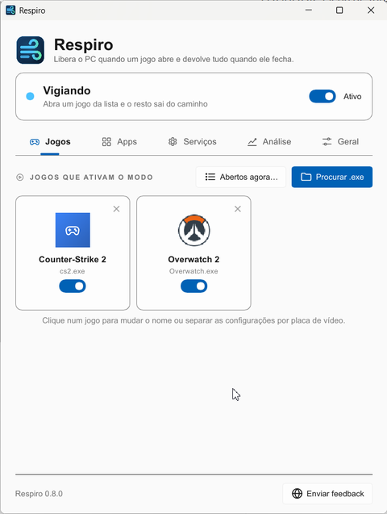
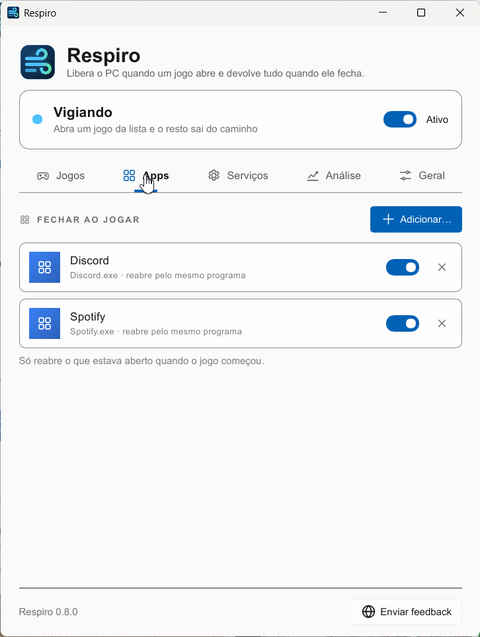
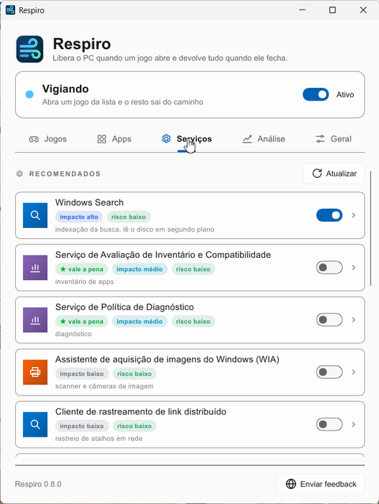
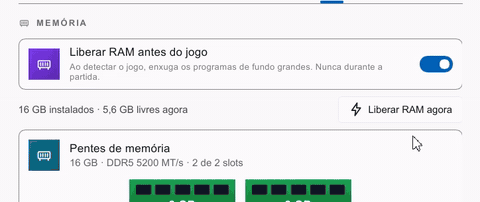
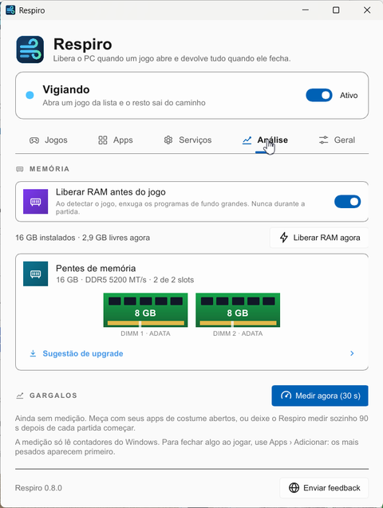
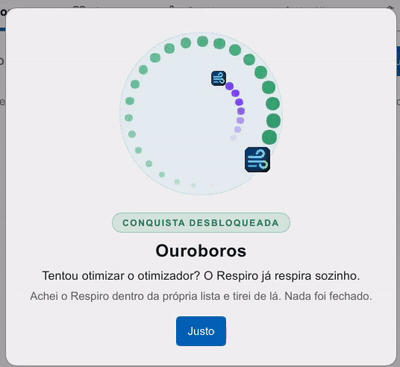

# 🌬️ Respiro

**Modo jogo para Windows: quando um jogo seu abre, o Respiro tira do caminho o que está sobrando no PC. Quando o jogo fecha, ele devolve tudo como estava, sozinho.**

&nbsp;

&nbsp;

---

## ⬇️ Baixar e instalar

1. Baixe o **`Respiro-x.y.z-instalador.exe`** na [página da última versão](https://github.com/LightWolfMan/respiro-releases/releases/latest).
2. Abra o instalador. Não precisa ser administrador.
3. Na última tela, deixe marcado **"Permitir que o Respiro pare serviços e libere memória"**. O Windows pede permissão **uma vez** e o Respiro não pergunta mais.

> [!NOTE]
> **O Windows vai mostrar uma tela azul dizendo "O Windows protegeu o computador".** Isso acontece com todo programa sem certificado pago, e não quer dizer que o Respiro seja perigoso. Clique em **Mais informações → Executar assim mesmo**.

**Já tem o Respiro?** A partir da 0.8, ele se **atualiza sozinho**: quando sai uma versão nova, aparece um aviso no rodapé da janela. Quem está na 0.7 precisa instalar a 0.8 uma vez por cima; as configurações continuam.

---

## 🎮 O que ele faz

<table>
<tr>
<td width="50%" valign="top">

**Detecta o jogo**  
Você escolhe seus jogos uma vez (pelo `.exe` ou pela lista de programas abertos). Quando um deles abre, o modo jogo liga sozinho.

**Fecha o que você escolher**  
Discord, navegador, launcher… só o que estiver na **sua** lista, e só se estiver aberto. Quando o jogo fecha, ele reabre o que fechou.

**Pausa serviços do Windows**  
Busca do Windows, telemetria, atualizações no meio da partida… Cada serviço mostra o que você ganha, o que perde e o risco. A Busca do Windows já vem marcada; o resto é com você.

</td>
<td width="50%" valign="top">

</td>
</tr>
<tr>
<td width="50%" valign="top">

</td>
<td width="50%" valign="top">

**Libera RAM antes de começar**  
Enxuga os programas de fundo **antes** da partida, nunca durante (mexer na memória no meio do jogo causa travadas).

**Ajustes de partida**  
Prioridade para o jogo, núcleos sempre acordados, energia no máximo (Windows 11), bloquear a tecla Windows, desligar os atalhos de acessibilidade. Tudo volta ao normal no fim.

**Overlays em um lugar só**  
Captura do Xbox, botão Xbox do controle, atalhos da AMD… desligue de uma vez, ou um por um, e restaure quando quiser.

</td>
</tr>
</table>

### Liberar RAM, ao vivo

O número que aparece é medido de verdade, várias vezes por segundo, enquanto a limpeza acontece:

### Análise

A aba **Análise** mostra seus pentes de memória, sugere upgrade quando faz sentido e mede o que está pesando no PC enquanto você joga (CPU, GPU, disco ou memória).

---

## 🔒 Segurança e privacidade

| | |
|---|---|
| **Tudo volta ao normal** | O que o Respiro muda durante a partida fica anotado num diário e é devolvido quando o jogo fecha, inclusive se o PC desligar no meio. |
| **Não toca no jogo** | Não injeta nada, não mexe em arquivos do jogo nem em anti-cheat. |
| **Sem telemetria** | O Respiro não envia nada sozinho. A única conexão automática é a busca por versão nova (um arquivo pequeno aqui no GitHub), e dá para desligar em **Geral → Atualizações**. |
| **Feedback só se você mandar** | O botão **Enviar feedback** mostra **exatamente** o texto que vai antes de enviar. Nada de nome de usuário, nome do PC, caminhos ou rede. |
| **Atualizações assinadas** | Cada versão é assinada digitalmente. O Respiro confere a assinatura e o hash antes de instalar e recusa qualquer arquivo adulterado. |
| **Desinstala limpo** | Pelo "Aplicativos instalados" do Windows. Ele devolve overlays, tira o início automático e remove as permissões de administrador antes de apagar os arquivos. |

---

## 💻 Requisitos

- **Windows 11** ou **Windows 10 versão 1607 ou mais nova** (inclusive LTSC 2019 e 2021), 64 bits.
- Uns 20 MB de disco. Nada para instalar junto (sem .NET, sem Visual C++).
- "Energia no máximo" só existe no Windows 11; no 10, a opção aparece desativada.

---

## ❓ Perguntas rápidas

<b>Vai me dar ban em algum jogo?</b>

 
Não. O Respiro não encosta no processo do jogo: só fecha <b>outros</b> programas que você escolheu, pausa serviços do Windows e ajusta prioridade e energia, como você faria pelo Gerenciador de Tarefas.

<b>E se o PC travar ou desligar no meio da partida?</b>

 
Na próxima vez que o Respiro abrir, ele lê o diário e devolve o que ficou pendente (serviços, ajustes e apps fechados).

<b>Ele fica rodando o tempo todo?</b>

 
Fica na bandeja, perto do relógio, esperando um jogo abrir, e gasta quase nada parado. Fechar a janela não fecha o app; para sair, use <b>Sair</b> no ícone da bandeja. Se quiser que ele abra com o Windows, ligue em <b>Geral → Iniciar com o Windows</b>.

<b>Achei um problema ou tive uma ideia</b>

 
Use o botão <b>Enviar feedback</b> no rodapé do Respiro. Ele já junta as informações que ajudam a entender o que aconteceu (e você vê tudo antes de mandar).

<b>Tentei otimizar o próprio Respiro e apareceu uma cobra 🐍</b>

 
 
Parabéns, você desbloqueou uma conquista. 😄

---

Este repositório guarda só os instaladores; o código do Respiro é privado. Feito em Rust.

